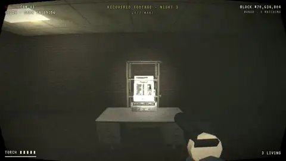

# HOLLOW — *something is wearing you*

**An open-world, body-swap psychological horror game where every footstep is a Monad transaction.**



*Recovered footage of night 3, rebuilt from Monad testnet data: MARA is touched at the 24/7 Mart (block 70,634,810, proven onchain) and becomes Hollow, still wearing the same body.*

Up to eight souls wake up in Halden, an abandoned company town at night. Every 30–75 seconds the Monad chain reshuffles who is wearing whom: you wake up in someone else's body, with someone else's name on your chest and someone else's things in your pockets, while a stranger walks around in yours. One of you is **Hollow**. It turns whoever it touches, and they become Hollow too. Find three fuses, power the bridge gate, get out.

Spectators ("watchers") can open any running night, switch between everyone's bodycams, and pay MON to torment the players: kill the lights, whisper, scream, force an early swap. Every fee and every shop purchase goes into the night's pot. The souls who escape split it, and if nobody escapes, the Hollow keeps it.

> Metropolis Hackathon · Track 03 — Social, Attention & Culture

- **Play:** _GitHub Pages link — see [Deployment](#deployment)_
- **Demo video:** _link added at submission_
- **Contract (Monad testnet, chain 10143):** [`0x5C4ef8456A07c61687d72827709Ff65569BB2957`](https://testnet.monadvision.com/address/0x5C4ef8456A07c61687d72827709Ff65569BB2957)

---

## Track 03 — Social, Attention & Culture

| The track asks for | HOLLOW |
| --- | --- |
| **Competitive feeds** | **The Archive** lists every finished night with its outcome: who was the Hollow, who was turned, who got out, who took the pot. **The Haunted** ranks souls by MON won, wins, escapes and nights spent Hollow. Both are read straight from the contract. |
| **Attention that turns into ownership** | Watchers pay MON to torment players they are watching. Every fee and every shop sale goes into the night's pot, and the contract pays it to the winners. Spectators' attention becomes the players' money, with no platform in between. |
| **Cultural participation** | Every night is permanent and can be watched again, rebuilt from chain data as recovered bodycam footage, and shared as a link (`?replay=<night>`). The end screen has **COPY FOOTAGE LINK**. |
| **Open social graph** | Names, souls, bodies and outcomes are public contract state. Anyone can build on them, and the leaderboard is one example. |

## Why this only works on Monad

| What HOLLOW does | Why it needs Monad |
| --- | --- |
| Every body's position is recorded onchain every 2 blocks (0.6 s), batched up to 8 samples per transaction | ~1–2 transactions per second per player. Needs 300 ms blocks and very cheap gas. |
| Body swaps happen on the exact block for every player | Each shift is seeded by the previous block's hash; with 300 ms blocks the swap is effectively instant and simultaneous. |
| Touches, fuses, escapes and shop purchases are **proven** against the recorded positions | Anyone can submit a proof; the contract checks both bodies' samples at the same block. No server decides who died. |
| Watchers pay to torment live players | A 0.01 MON torment lands in ~0.3 s, while the victim is still standing in that corridor. |
| Players' moves never touch each other's storage | Each body's samples live in their own storage page, so different players' transactions can execute in parallel on Monad. |
| A move costs ~65k gas | The town is baked into the bytecode (immutables, no storage reads), and a move touches exactly two page-aligned storage regions: its night's record and its body's samples. |

The bodycam HUD shows the block number as its timestamp, blinks `● REC` on every Monad block, and lists your own transactions with their confirmation latency. The streetlights dip with every new block, so the town breathes with the chain.

## How it plays

- **Shifts.** Every 30–75 s all souls are reshuffled into different bodies (a random single-cycle permutation, so nobody stays put). The camera cuts to static, you wake up somewhere else, and you don't know whose body you're in until you look down at your wrist ID band. Your original body's heartbeat is on your wrist; if whoever wears it gets turned, it reads **SIGNAL LOST**.
- **The Hollow.** One soul (two with 6+ souls) starts Hollow, drawn from the hash of the block before the night begins. A Hollow-controlled body turns any living-controlled body within 1.2 m. The turned soul becomes Hollow in place and keeps playing as a hunter. Every body looks the same; nothing gives the Hollow away.
- **Halden.** A 192 m × 192 m town with rain, fog and dead streetlights. The three fuses are inside the Archive (a backrooms office maze), St. Agnes Hospital, and Halden Station. The exit is the bridge gate.
- **Shops.** The 24/7 Mart, the pharmacy and Koda Photo sell batteries, flares, a music-box lure, pills, adrenaline and a Polaroid that shows who is really inside a body. Purchases are transactions, and items go into the **body's** pockets, so after a swap someone else gets your things.
- **Your own mind.** Sanity drains in the dark. Then you see figures that aren't there, hear footsteps that stop when you stop, sit through swaps that never happened, and hear the browser's own voice say other players' names.
- **Permanence.** The intro reads your real public Monad history. The end screen lists every transaction hash of your night: *your fear is now permanent.*
- **Recovered footage.** Every finished night can be watched again, rebuilt from nothing but chain data: the header, the epoch history, every body's samples and the night's events. It plays back through the bodycams, cutting to whoever is closest to a Hollow, and touches, fuses, swaps, flares and voices land on their blocks. Open a finished night in the lobby (**WATCH THE FOOTAGE**) or go straight to `?replay=<night>`.

Full rules and numbers: [`docs/GDD.md`](docs/GDD.md).

Controls: `WASD` move · `Shift` run · mouse look · `F` torch · `E` shop terminal · `Tab` select item · `Q` use item · `M` map · `1–6` voice lines · look down for your wrist · `H` help.

## Architecture

```
contracts/          Foundry project
  src/Hollow.sol    the whole game: nights, souls, bodies, samples, shifts, proofs, shops, watchers, pot
  test/             24 tests (lobby, recording rules, wall/teleport checks, shifts, turns, fuses,
                    escape, shops & pockets, watchers & pot, plus one regression test per exploit
                    found in review and one that pins the page-aligned storage layout)
  script/           deployment (reads the generated town)
tools/map/          Halden generator → walls bitmap, spawns, objectives, render description
web/                Vite + TypeScript + three.js client
  src/chain/        burner session wallet & tx engine, NightState (mirrors the contract,
                    predicts shifts from block hashes, finds proofs), Pilot (records your samples),
                    ReplayNight (rebuilds a finished night from chain data)
  src/game/         world (town renderer), player (FPS controller), figures, fx (bodycam
                    post-processing), audio (HRTF voices, synthesized rain/thunder), psych
                    (sanity & hallucinations), town (shops, items, map), game (the loop)
  scripts/bots.mjs  bots that play by the contract rules (demos, playtests, filling seats)
  scripts/verify-shifts.mjs   recompute every swap of a night from block hashes
  scripts/gas-report.mjs      per-function gas of a block range
tools/audio/        offline voice + SFX generator (Kokoro-82M TTS, numpy DSP)
tools/film/         deterministic capture of the demo video from the game itself
docs/GDD.md         game design document
```

**Data flow.** Each client polls one `snapshot()` view per block (night header, current epoch, every body's latest samples), reads `getSouls`/`getEpochs`/`getPockets`, and fetches `Torment`/`Used` logs. Your own body's samples are signed locally by a burner session wallet and sent with `eth_sendRawTransaction` (no popups, local nonce, fixed gas limits, since Monad charges the gas limit). Swaps are computed locally from block hashes with the same algorithm as the contract, so they land on the exact block. Proofs are found client-side and submitted by whoever sees them first.

**Monad's reserve-balance rule.** An account holding less than 10 MON may only send *value* if it sent no other transaction in the previous 3 blocks. Players stream movement transactions every ~2 s, so the session wallet opens a short quiet window before any value-carrying call (shop purchases, watcher torments), and the bots space their funding transfers. Fresh funds are also given a few seconds to settle, because Monad validates balances against slightly lagged state.

**Audit any night.** `node web/scripts/verify-shifts.mjs --rpc https://testnet-rpc.monad.xyz --hollow <address> --night <id>` recomputes every body swap from public block hashes and checks it against the contract.

**Contract rules worth knowing.**
- Samples: `x | y << 16` in cm, one per body every 2 blocks, append-only. Speed cap 4.2 m per sample, every hop is probed every 1.4 m for walls, and samples must be submitted within 16 blocks (~4.8 s). A gap means the body stood still, and the sample that ends a gap may cover at most 8 samples' worth of ground.
- Shifts: seed = `keccak(blockhash(S−1), night, epoch)`, Sattolo's algorithm over bodies still in play; next shift = `S + 100 + seed % 150`.
- Proofs: `turn`, `collectFuse`, `escape` and `buy` all take an epoch and a sample index and are checked against the stored samples and that epoch's body→soul assignment.

## Tech stack

Solidity 0.8.33 + Foundry · TypeScript + Vite · three.js r169 + postprocessing (pmndrs) · viem · WebAudio · Kokoro-82M TTS (offline, for the voice pack) · Blender 4.2 (character model) · Poly Haven CC0 assets · Node bots.

## Setup

Requirements: Node 20+, Foundry.

```bash
# contracts
cd contracts
forge test                     # 24 tests

# local chain with Monad-like 300 ms blocks
anvil --block-time 0.3
forge script script/Deploy.s.sol --rpc-url http://127.0.0.1:8545 --broadcast \
  --private-key 0xac0974bec39a17e36ba4a6b4d238ff944bacb478cbed5efcae784d7bf4f2ff80

# web client
cd ../web
npm install
node scripts/sync-contract.mjs          # copies ABI + map into the client
# put the local address under "31337" in src/deployments.json, then:
npm run dev                             # open http://localhost:5173/?local=1

# fill a night with bots (they wait until 6 souls have joined, then start)
node scripts/bots.mjs --hollow <address> --create --start-when 6 --count 5
```

`?quality=low|high` forces a graphics level (default adapts to your frame rate).

### Monad testnet

```bash
cd contracts
forge script script/Deploy.s.sol --rpc-url https://testnet-rpc.monad.xyz --broadcast --private-key $PRIVATE_KEY
# put the address under "10143" in web/src/deployments.json (or set VITE_HOLLOW_ADDRESS)
cd ../web && npm run build
```

Players need a little testnet MON in their session wallet (shown on the title screen; [faucet](https://faucet.monad.xyz)). A movement transaction carries ~4 samples (2.4 s of walking) and costs about 0.007 MON at the 100 gwei base fee, because Monad charges the full gas limit. Standing still is free. The **withdraw all** button sends whatever is left back to your wallet.

Bots on testnet: `BOT_MNEMONIC="..." FUNDER_KEY=0x... node scripts/bots.mjs --rpc https://testnet-rpc.monad.xyz --hollow <address> --fund 0.6 --create --start-when 4 --count 3` (`--speed 1.4` makes them run). Each bot spends about 0.6 MON in 2.5 minutes of constant movement. `ESTIMATE=1` makes them `eth_estimateGas` every call and print the gas distribution.

Replays: `http://localhost:5173/?replay=3` rebuilds night 3 from Monad testnet (`&cam=1` pins a bodycam, `&speed=2` plays faster). The demo video's footage is night 3 of the contract above.

### Deployment

`.github/workflows/pages.yml` builds `web/` and publishes it to GitHub Pages on every push to the main branch. Enable it under **Settings → Pages → Source: GitHub Actions**.

## Security

HOLLOW holds real value (the pot), so the contract was reviewed adversarially. Every finding has a regression test in `contracts/test/Hollow.t.sol`.

**Design**
- **No admin.** No owner, no upgrade path, no pause, no withdraw. MON leaves the contract only through `claimPot`, to the winners of the night it was paid into.
- **Exact payments.** Shop prices and torment fees must be paid exactly, so nothing is silently overpaid.
- **Checks-effects-interactions** in `claimPot`: the claim is recorded before the transfer.
- **Bounded loops.** Shifts are applied at most 16 at a time and 40 per night. Proofs walk a body's samples one slot (8 samples) at a time over a 128-slot array.
- **Randomness.** Roles are drawn from the hash of a block that doesn't exist when `start()` is called, so the starter can't simulate and retry for a role. Shifts use the hash of the block before each shift, and anyone can recompute them (`verify-shifts.mjs`).

**Fixed in review**

| Issue | Impact | Fix |
| --- | --- | --- |
| `rollOver` could move an unclaimed pot into any later night, including a lobby that never starts | Anyone could lock a pot forever, or farm failed nights' pots with a solo night | Removed. The winners are the escapees, or the Hollow if nobody escaped. The pot never leaves its night. |
| A sample after a gap could reach `4.2 m × gap length` | Stop recording, walk anywhere unseen, reappear | The sample ending a gap may cover at most the late window's worth of ground (8 samples) |
| Long hops were only wall-checked at their midpoint | Could pass through a building on a long hop | Every hop is probed every 1.4 m |
| Proofs gave up after scanning 256 empty samples | A camper could resume recording right after a touch and make the proof revert | Gaps of any length are provable |
| Roles were assigned inside `start()` | The host could simulate `start()` and revert until they were (not) Hollow | Roles come from a future block hash |
| Samples could arrive up to 40 blocks late | Long retroactive "time travel" to intercept or dodge | 16 blocks (~4.8 s) |

**Client**
- The session key is generated and kept in the browser (localStorage) and only ever signs calls to the Hollow contract. Keep small amounts in it; **withdraw all** sweeps the rest to your wallet.
- Every call except movement is **simulated first** (`eth_estimateGas`). A call that would revert is not sent (on Monad a revert still pays the whole gas limit), and the limit is the estimate plus a margin. Movement calls size their own limit from measured costs.
- The client mirrors the contract's movement rules, so it never sends a move the chain would reject. If a transaction is lost and the player outruns what the chain can accept, the body is pulled back to its onchain position.
- RPC responses and onchain strings are untrusted: transaction hashes are format-checked before they reach the page, and player names are escaped.

## Known limitations

- **Hidden roles are hidden in the UI, not cryptographically.** All game state is onchain and public, so a determined player could read who is Hollow from the chain. Commit-reveal or ZK shuffles would fix this; out of scope for the hackathon.
- Positions are self-reported within the contract's rules (speed cap, wall probes, gap cap, 16-block submission window). A modified client could play optimally within those rules. For example, it could hold back its samples for up to ~4.8 s and pick its path after seeing others'.
- Proofs are first-come: if a living soul's escape lands before a proof that they were touched earlier, the escape stands.
- Items' effects (battery, pills, adrenaline) are applied client-side; their purchase and use are onchain.

## Built during the hackathon

Everything in this repository was created during the Metropolis hackathon window. No pre-existing project code is used. Third-party code is limited to the open-source libraries listed in `web/package.json` and `forge-std` (vendored in `contracts/lib/forge-std`, MIT/Apache-2.0).

## AI disclosure

This project was built with heavy use of AI tools, as the rules require us to disclose. **Claude Code (Anthropic)** wrote most of the code under the team's direction:
- the contract, its tests and the security review;
- the web client, the map generator and the bots;
- the audio generator (Kokoro-82M TTS and numpy DSP);
- the demo-video tooling, slides and narration script;
- the docs.

It also sourced and optimized the CC0 Poly Haven assets and scripted the character model in Blender. All voices in the game and in the demo video, including the narrator, are synthetic: Kokoro-82M, generated offline. Game direction, concept decisions and playtesting were done by the team.

## Credits

- 3D assets, textures and HDRI: [Poly Haven](https://polyhaven.com) (CC0). See `web/public/assets/CREDITS.md`.
- Voices: [Kokoro-82M](https://huggingface.co/hexgrad/Kokoro-82M) (Apache-2.0) via kokoro-onnx (MIT). Sound effects synthesized for this project. See `web/public/audio/CREDITS.md`.
- Fonts: VT323, Special Elite, Inter via Google Fonts (OFL).
- Libraries: three.js (MIT), postprocessing (Zlib), viem (MIT), Foundry/forge-std (MIT/Apache-2.0).

## License

[MIT](LICENSE)
